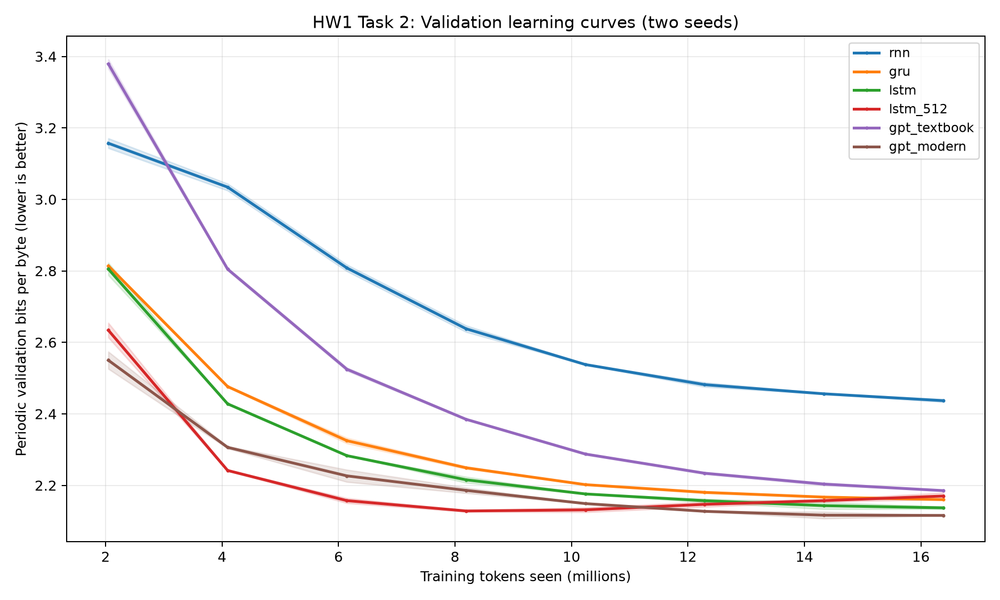
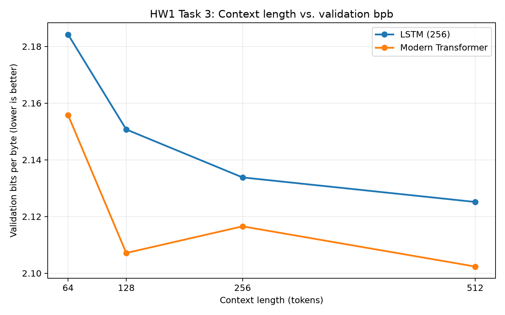
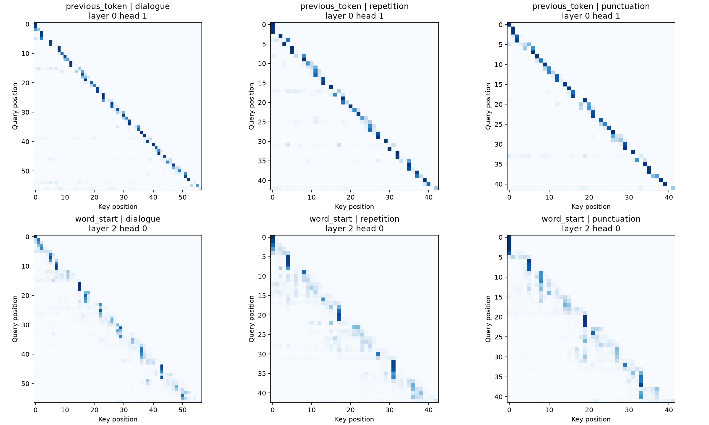

# Language Models from Scratch — Homework 1

**San José State University · Deep Learning · Fall 2026**  
**Author:** Mohit Manoj Barade  
**Dataset:** Tiny Shakespeare · **Framework:** PyTorch / `nanolm` · **Hardware:** Apple M4 (MPS, FP32)

This repository documents a hands-on study of **character-level language modeling**: verifying evaluation metrics, comparing recurrent and Transformer architectures, measuring the effect of context length, interpreting attention heads, and studying the trade-off between sampling diversity and readability.

The work follows the instructor's [`nanolm` tutorial](https://github.com/lkk688/DeepDataMiningLearning/blob/main/DeepDataMiningLearning/llm/TUTORIAL_nanolm.md). The experiments, analysis scripts, metrics, figures, and reports are organized by task to make the results auditable and reproducible.

> **Main result:** Under a matched **16,384,000-token training budget**, the modern Transformer was the best of six architectures in the two-seed comparison (**2.1159 mean validation bits per byte**). In a separate context-length study, the same model family reached **2.1024 bpb** at 512 characters. Lower bpb is better.

## Assignment at a glance

| Part | Experiment | Scope | Main observation | Report |
|:--|:--|:--|:--|:--|
| **1** | Metrics by hand | Trained LSTM; one-step character and byte models | Recomputed perplexity and bpb match logged values | [Task 1](report/HW1_Task1_Metrics_Report.md) |
| **2** | Architecture comparison | 6 architectures × 2 seeds = **12 runs** | Modern Transformer ranks first; vanilla RNN last | [Task 2](report/HW1_Task2_Architectures_Report.md) |
| **3** | Context-length study | 2 architectures × 4 contexts = **8 runs** | Longer context helps overall, with diminishing LSTM gains | [Task 3](report/HW1_Task3_Context_Report.md) |
| **4** | Attention interpretation | 3 texts; 16 attention heads | Distinct previous-character and word-start patterns | [Task 4](report/HW1_Task4_Attention_Report.md) |
| **Extra credit** | Sampling and qualitative analysis | **90 outputs**, 9 settings, 10 seeds/setting | Greater 4-gram diversity often accompanies lower readability | [Extra credit](report/HW1_Extra_Credit_Report.md) |

**Complete submission:** [Full homework report (Word)](report/HW1_Language_Models_From_Scratch_Full_Report.docx) · [All task reports](report/)

---

## 1. Metrics by hand

I trained a 256-hidden-unit character LSTM for 2,000 steps and independently recalculated the evaluation metrics from its logged validation loss.

| Metric | Trained character LSTM |
|:--|--:|
| Parameters | 1,069,824 |
| Validation cross-entropy | **1.493252 nats/token** |
| Perplexity, `exp(loss)` | **4.451548** |
| Bits/token, `loss / ln(2)` | **2.154307** |
| Bits/byte | **2.154307** |
| Validation tokens / bytes | 111,488 / 111,488 |

For a uniform predictor, the theoretical cross-entropy is `ln(vocabulary_size)`. The near-untrained models received **one optimizer step**, so they are not strictly zero-step uniform predictors:

| Tokenizer | Vocabulary | Uniform `ln(V)` | Observed one-step loss |
|:--|--:|--:|--:|
| Character | 65 | 4.174387 | 4.178698 |
| Byte | 256 | 5.545177 | 5.687762 |

**Takeaway:** Recomputed perplexity and bpb agree with the stored metrics. Bits per byte is used in the remaining experiments because it normalizes predictive cost by the amount of text rather than tokenizer-dependent token counts.

[Read the full Task 1 analysis](report/HW1_Task1_Metrics_Report.md)

## 2. Architecture comparison

Six language-model architectures were trained with the **same dataset, sequence length (256), batch size (32), 2,000 steps, and 16.384 million training tokens per run**. Each model was trained with seeds **1337** and **42**.

| Model | Parameters | Validation bpb, mean ± sample SD |
|:--|--:|--:|
| Vanilla RNN | 280,320 | 2.4369 ± 0.0056 |
| GRU | 806,656 | 2.1600 ± 0.0018 |
| LSTM — 256 hidden units | 1,069,824 | 2.1371 ± 0.0048 |
| LSTM — 512 hidden units | 4,236,800 | 2.1701 ± 0.0132 |
| GPT-2-style Transformer | 3,438,336 | 2.1852 ± 0.0016 |
| **Modern Transformer** | **3,162,624** | **2.1159 ± 0.0010** |



*Figure 1. Validation learning curves over training-token exposure. Lower bpb is better.*

**What the comparison shows:**

- **Vanilla RNN:** Worst final validation bpb, consistent with difficulty preserving long-range information and gradients. It also has fewer parameters, so the comparison does not isolate gating by itself.
- **GRU and LSTM:** Both gated recurrent architectures substantially outperform the vanilla RNN.
- **Larger LSTM:** Despite having nearly four times the parameters of the smaller LSTM, it finishes worse (**2.1701 vs. 2.1371 bpb**). Its validation curve initially improves, then deteriorates late in training; that is *consistent with*, but not conclusive proof of, overfitting.
- **Modern Transformer:** Best final mean bpb (**2.1159**), outperforming the textbook/GPT-2-style Transformer (**2.1852**) with slightly fewer parameters.

[Read the full Task 2 analysis](report/HW1_Task2_Architectures_Report.md)

## 3. Does more context help?

I compared the 256-unit LSTM and modern Transformer at context lengths **64, 128, 256, and 512**. Batch sizes were adjusted to keep **8,192 training tokens per step**; all eight runs used **2,000 steps, seed 1337, and 16.384 million training tokens each**.

| Context length | Batch size | LSTM validation bpb | Modern Transformer validation bpb |
|--:|--:|--:|--:|
| 64 | 128 | 2.184226 | 2.155792 |
| 128 | 64 | 2.150726 | 2.107150 |
| 256 | 32 | 2.133803 | 2.116539 |
| **512** | **16** | **2.125149** | **2.102364** |



*Figure 2. Context-length sweep for LSTM and modern Transformer.*

The LSTM improves steadily but with **diminishing returns beyond roughly 256 characters**. The Transformer obtains lower bpb at all four lengths, although its trend is not perfectly monotonic and **no clear plateau** is established up to 512. This is a **single-seed** comparison, and equal training tokens do not imply equal training FLOPs.

[Read the full Task 3 analysis](report/HW1_Task3_Context_Report.md)

## 4. What did the attention heads learn?

Using the **512-context modern Transformer checkpoint from Task 3** (validation bpb **2.102364**), I inspected the model's **4 layers × 4 heads** on three inputs: dialogue, repeated words, and a punctuated sentence. I measured the average causal attention weight on two hypothesized positions.

| Attention pattern | Layer / head (zero-based) | Eligible queries | Mean target weight | Uniform-causal baseline | Enrichment |
|:--|:--|--:|--:|--:|--:|
| **Previous character** | Layer 0, Head 1 | 139 | **50.35%** | 7.41% | 6.79× |
| **First character of current word** | Layer 2, Head 0 | 82 | **44.13%** | 7.50% | 5.89× |



*Figure 3. The previous-token head (top row) shows attention near the subdiagonal; the word-start head (bottom row) attends to earlier characters within words.*

The numerical results and maps support **interpretable candidate patterns**. However, attention allocation alone does not prove a head's exclusive function or causal influence on predictions.

**Evidence:** [Head-by-text scores](task4_attention/attention_scores_by_text.csv) · [Summary](task4_attention/attention_scores_summary.csv) · [Task 4 analysis](report/HW1_Task4_Attention_Report.md)

## 5. Extra credit — sampling diversity versus text quality

A fixed Transformer checkpoint was used to generate text from `ROMEO:\n` at **three temperatures (0.5, 1.0, 1.5)** and **three top-p thresholds (0.8, 0.9, 1.0)**. The extended evaluation used **10 generation seeds per setting**, or **90 passages of 200 generated characters**. Top-k filtering was disabled.

The diversity metric is **Distinct-4**, the number of unique overlapping *character* 4-grams divided by all overlapping character 4-grams in the **generated suffix only**.

| Temperature | Top-p | Distinct-4, mean ± SD | Readability / 5 | Coherence / 5 |
|--:|--:|--:|--:|--:|
| 0.5 | 0.8 | 81.52% ± 6.11 pp | 4.00 | 3.33 |
| 1.0 | 0.9 | 93.86% ± 2.34 pp | 3.00 | 2.33 |
| 1.5 | 1.0 | **98.33% ± 1.31 pp** | **1.33** | **1.33** |


*Figure 4. Mean distinct character 4-grams across all nine temperature/top-p combinations.*


*Figure 5. Greater local novelty was accompanied by lower readability ratings in this small evaluation.*

**Interpretation:** Higher temperature and less restrictive top-p sampling generally increased character 4-gram diversity. But the highest-diversity setting was rated least readable and coherent. **Diversity is not a substitute for fluency or quality.**

**Evaluation transparency:** A subset of **27 passages (three per setting)** was evaluated by **ChatGPT** using a blinded 1–5 rubric for readability, coherence, and repetition severity. These are **subjective AI-assisted ratings, not an independent human study**. They are descriptive and should not be interpreted as objective or causal quality measurements. The **2.102364 validation bpb** remained fixed because decoding choices do not update model weights.

[Read the complete extra-credit study](report/HW1_Extra_Credit_Report.md)

---

## Repository structure

```text
LLM-from-scratch-HW1/
├── README.md
├── task1_metrics/                 # Trained and near-untrained metric evidence
├── task2_architectures/          # Six-model sweep, two seeds, learning curves
├── task3_context_length/         # Eight-run context sweep and results
├── task4_attention/              # Attention maps, selected heads, per-head CSVs
├── extra_credit_sampling/        # Sampling grid and extended qualitative review
├── scripts/                      # Reproduction and analysis scripts
│   ├── run_task3.py
│   ├── run_task4.py
│   ├── run_extra_credit.py
│   ├── extend_extra_credit.py
│   └── finalize_extra_credit_review.py
└── report/
    ├── HW1_Task1_Metrics_Report.md
    ├── HW1_Task2_Architectures_Report.md
    ├── HW1_Task3_Context_Report.md
    ├── HW1_Task4_Attention_Report.md
    ├── HW1_Extra_Credit_Report.md
    ├── HW1_Language_Models_From_Scratch_Full_Report.docx
    └── extra_credit_figures/
```

The instructor's `DeepDataMiningLearning/` source checkout, local virtual environment, and large model checkpoints are **not intended for version control**. The repository stores experiment code and lightweight results; checkpoint-dependent analysis requires the corresponding local checkpoint.

## Reproducing the experiments

### Prerequisites

- Python with PyTorch and the instructor's `nanolm` dependencies installed.
- The instructor's [`DeepDataMiningLearning` repository](https://github.com/lkk688/DeepDataMiningLearning) checked out locally.
- For **Tasks 4 and Extra Credit**, the saved modern Transformer checkpoint (`model.pt`) from the 512-context run.
- The original experiments used a Mac with Apple's **MPS** backend. Other devices can run the code with suitable configuration, but timings may differ.

The folder layout used for the experiments places the instructor's repository under `DeepDataMiningLearning/` inside this repo. Set the library path accordingly:

```bash
# From the root of LLM-from-scratch-HW1
export NANOLM_DIR="$PWD/DeepDataMiningLearning/DeepDataMiningLearning/llm"
source "$NANOLM_DIR/.venv/bin/activate"  # after setting up the instructor's environment
```

Install the instructor's dependencies following the [official tutorial](https://github.com/lkk688/DeepDataMiningLearning/blob/main/DeepDataMiningLearning/llm/TUTORIAL_nanolm.md) before running the scripts. The commands below presume the required environment, data, and checkpoints are available; they should **not** be interpreted as instant reproduction without training.

```bash
# Task 3: validate the eight-run plan; then train or summarize saved runs
python scripts/run_task3.py --dry-run
python scripts/run_task3.py --run
python scripts/run_task3.py --summarize

# Task 4: reuse the modern Transformer checkpoint
python scripts/run_task4.py --dry-run
python scripts/run_task4.py --run

# Extra credit: original two-seed grid, then ten-seed extension
python scripts/run_extra_credit.py --run
python scripts/extend_extra_credit.py --run

# Qualitative evaluation: analyze filled-in review ratings
python scripts/finalize_extra_credit_review.py
```

**Important reproduction notes:**

1. Task 2 uses a YAML sweep in `task2_architectures/` and its accompanying orchestration script(s). The full experiment settings are described in the [Task 2 report](report/HW1_Task2_Architectures_Report.md). Task 1's raw metrics and calculations are described in its dedicated report.
2. `run_task3.py --run` performs training, not just plotting. `--summarize` requires the completed training outputs.
3. Task 4 and Extra Credit use the existing checkpoint under the instructor's local `outputs/nanolm/sweeps/hw1_context_length/` directory. Their scripts accept `--run-dir` to select an alternate checkpoint location.
4. Re-running experiments with different hardware, software versions, or random seeds can change results; the tables above report the recorded runs.

## Evaluation principles and limitations

- **Validation bpb is lower-is-better** and is the primary quality metric for modeling character-level Tiny Shakespeare.
- Task 2 equalizes **training-token budget**, not model parameters or total computation.
- Task 3 includes **one training seed per context** and changes batch size to preserve token count.
- The attention-head patterns in Task 4 are **descriptive observations**, not mechanistic proof.
- Sampling diversity and language quality are **different quantities**; the extra-credit qualitative judgments were made by an AI evaluator.

## Reports and references

- **Full report:** [`report/HW1_Language_Models_From_Scratch_Full_Report.docx`](report/HW1_Language_Models_From_Scratch_Full_Report.docx)
- **Task reports:** [Metrics](report/HW1_Task1_Metrics_Report.md) · [Architectures](report/HW1_Task2_Architectures_Report.md) · [Context](report/HW1_Task3_Context_Report.md) · [Attention](report/HW1_Task4_Attention_Report.md) · [Extra Credit](report/HW1_Extra_Credit_Report.md)
- **Instructor tutorial:** [TUTORIAL_nanolm.md](https://github.com/lkk688/DeepDataMiningLearning/blob/main/DeepDataMiningLearning/llm/TUTORIAL_nanolm.md)
- **Instructor implementation:** [DeepDataMiningLearning](https://github.com/lkk688/DeepDataMiningLearning)

**Repository:** https://github.com/mohiitt/LLM-from-scratch-HW1
