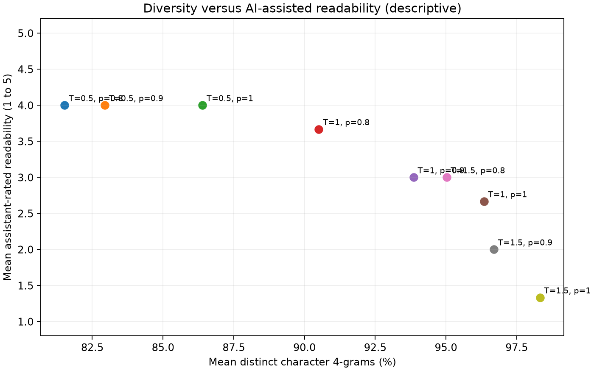

# Extra Credit Extension — Additional Seeds and Blinded Assistant Review

## Method

**Reviewer provenance:** The 27 passages were rated by ChatGPT, not by an independent human reviewer. Scores should be described as AI-assisted qualitative ratings; their subjectivity and limited reliability must be acknowledged.

- Same Tiny Shakespeare character Transformer checkpoint and prompt as the original experiment.
- Temperature = 0.5, 1.0, 1.5; top-p = 0.8, 0.9, 1.0.
- Ten sampling seeds per setting (90 generated 200-character passages total).
- 27 passages were randomly ordered and scored by ChatGPT without displaying sampling settings:
  three independent seeds per setting (2, 5, 8).
- Ratings are subjective, produced by one AI evaluator using 1–5 scales for readability,
  coherence, and repetition severity (higher repetition severity is worse).
- Checkpoint validation bpb remains 2.102364; sampling does not retrain the model.

## Quantitative and qualitative results

| Temperature | Top-p | Distinct 4-grams % (mean ± SD) | Readability /5 | Coherence /5 | Repetition severity /5 |
|---:|---:|---:|---:|---:|---:|
| 0.5 | 0.8 | 81.52 ± 6.11 | 4.00 | 3.33 | 1.67 |
| 0.5 | 0.9 | 82.94 ± 5.31 | 4.00 | 2.67 | 2.00 |
| 0.5 | 1 | 86.40 ± 4.74 | 4.00 | 3.33 | 1.00 |
| 1 | 0.8 | 90.51 ± 4.32 | 3.67 | 2.67 | 1.33 |
| 1 | 0.9 | 93.86 ± 2.34 | 3.00 | 2.33 | 1.00 |
| 1 | 1 | 96.34 ± 1.64 | 2.67 | 2.00 | 1.33 |
| 1.5 | 0.8 | 95.03 ± 2.31 | 3.00 | 2.00 | 1.33 |
| 1.5 | 0.9 | 96.70 ± 1.73 | 2.00 | 1.67 | 1.00 |
| 1.5 | 1 | 98.33 ± 1.31 | 1.33 | 1.33 | 1.00 |

## Interpretation checklist

- Compare increasing temperature *at fixed top-p*, then top-p *at fixed temperature*.
- Explain whether increased distinct-4 is accompanied by a loss of readability or coherence
  in these ratings; report any exceptions.
- State that these are descriptive AI-assisted ratings; avoid causal claims
  based on noisy sample means.
- Cite two short examples from `blinded_texts.md` after revealing the key:
  a relatively fluent passage and a less readable passage.
- Do not equate distinct-4 diversity with text quality.

## Limitations

Only one trained checkpoint, one fixed prompt, 200-character passages, and one AI
evaluator were used. Ten generation seeds improve repeatability but do not remove
subjectivity or eliminate sampling uncertainty.
