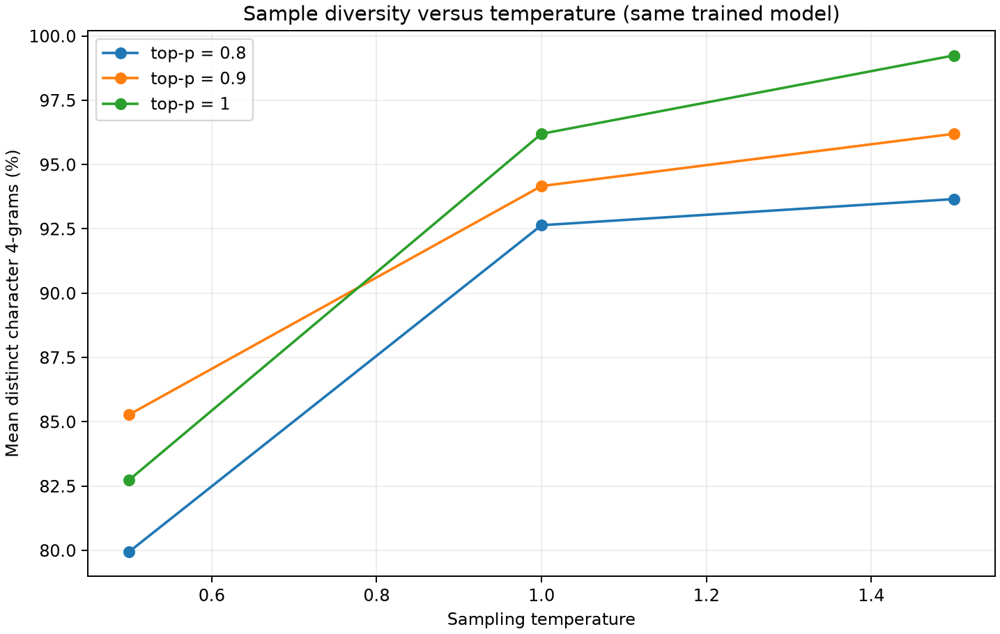
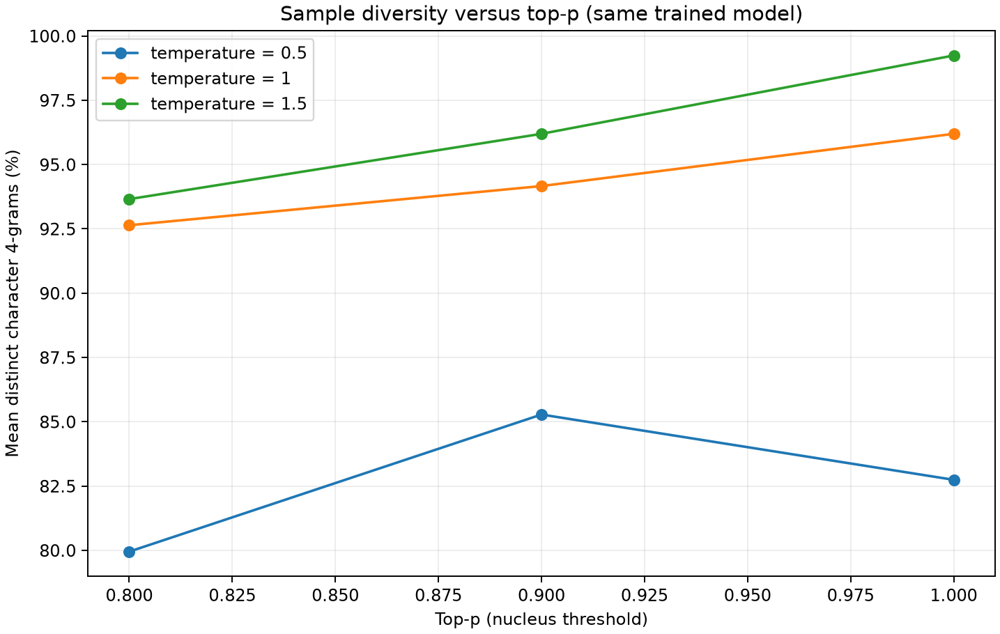
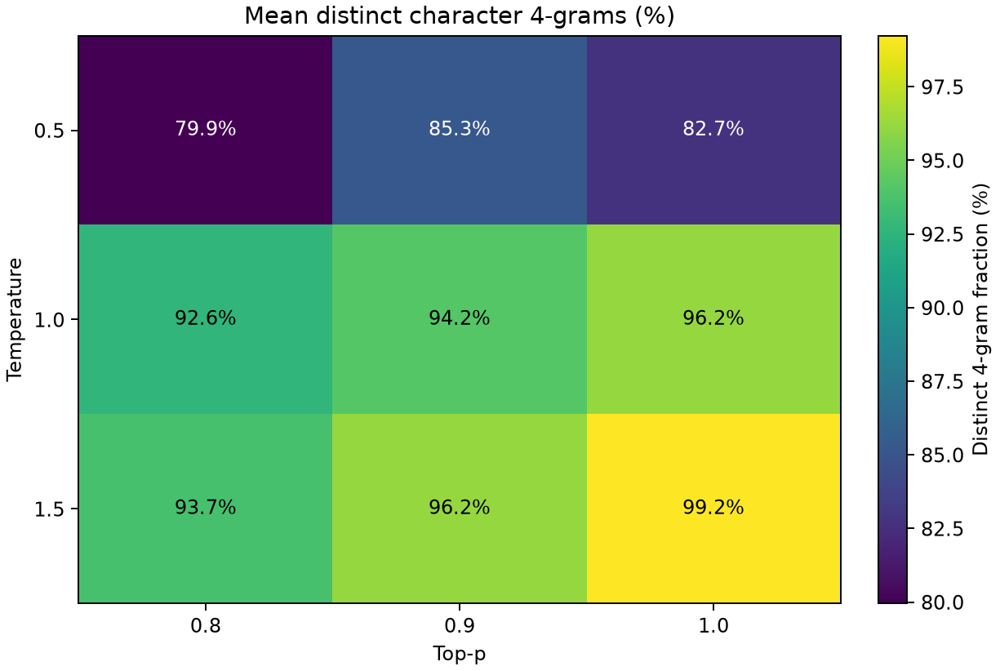

# HW1 Extra Credit — Sampling Diversity at Fixed Validation BPB

## Setup

- Checkpoint: `/Users/mohit/LLM-from-scratch-HW1/DeepDataMiningLearning/DeepDataMiningLearning/llm/outputs/nanolm/sweeps/hw1_context_length/gpt_modern_ctx512_s1337`
- Fixed checkpoint validation bpb: **2.102364**.
- Dataset: Tiny Shakespeare (character tokenizer).
- Fixed prompt: `ROMEO:\n`.
- New generated characters per sample: **200**.
- Generation seeds: **0, 1**.
- Top-k: **0** (disabled to avoid confounding temperature/top-p).
- Temperature values: **0.5, 1.0, 1.5**.
- Top-p values: **0.8, 0.9, 1.0**.

## Definition

Distinct 4-gram fraction = (number of unique overlapping character 4-grams) / (total overlapping character 4-grams) in the **generated suffix only**. A generated text of N characters has N-3 overlapping character 4-grams. The prompt is excluded. For each setting, the table reports the mean and sample standard deviation over independent generation seeds.

## Results

| Temperature | Top-p | Samples | Mean distinct 4-grams (%) | Sample SD (percentage points) |
|---:|---:|---:|---:|---:|
| 0.5 | 0.8 | 2 | 79.95 | 8.26 |
| 0.5 | 0.9 | 2 | 85.28 | 11.49 |
| 0.5 | 1 | 2 | 82.74 | 4.31 |
| 1 | 0.8 | 2 | 92.64 | 1.79 |
| 1 | 0.9 | 2 | 94.16 | 0.36 |
| 1 | 1 | 2 | 96.19 | 1.79 |
| 1.5 | 0.8 | 2 | 93.65 | 1.08 |
| 1.5 | 0.9 | 2 | 96.19 | 2.51 |
| 1.5 | 1 | 2 | 99.24 | 1.08 |

## Figures

## Interpretation guide

- Compare temperature at fixed top-p, and top-p at fixed temperature.
- Report the measured pattern, including any non-monotonic results; do not assume diversity must increase monotonically.
- This is diversity, not fluency, correctness, or linguistic quality. Inspect `samples/` for illustrative text.
- **Fixed bpb** means the same trained model is used for every sample. Validation bpb is calculated from its probability distribution on held-out text and does not change when only the sampling rule changes. This experiment does not claim that every generated sample has the same likelihood.
- Every setting uses identical prompt, number of generated tokens, model, context window, and generation seed list; only temperature and top-p vary.
- Limitations: short samples, a single checkpoint and fixed prompt; sample diversity alone does not capture semantic diversity or generation quality.

## Reproduction

`python scripts/run_extra_credit.py --run`

Raw data: `samples.csv`, `summary.csv`, and individual JSON samples in `samples/`.
