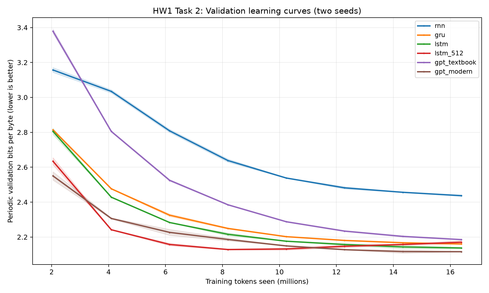

## 3. Task 2 — RNN, GRU, LSTM, and Transformer Comparison

### 3.1 Objective and controlled setup

I compared a vanilla RNN, GRU, 256-unit LSTM, 512-unit LSTM, GPT-2-style Transformer and modern Transformer to examine the practical effects of recurrent gating, model capacity and Transformer design. Every model used Tiny Shakespeare, **2,000 training steps, batch size 32, context length 256, and 16,384,000 training tokens**. Each configuration was run independently with **two seeds (1337 and 42)**, producing 12 completed runs. Validation bpb was the primary metric (lower is better). Per-step learning curves were recorded during training; final tabulated values came from the full validation-set metrics.

The modern Transformer used RMSNorm, RoPE, SwiGLU and no biases; the textbook Transformer used its GPT-2-style configuration. Models were matched for training tokens, not for parameter count, training time, or FLOPs. Sample standard deviation (SD) across two runs is shown to convey limited seed variability.

### 3.2 Results

| Architecture | Parameters | Seed 1337 bpb | Seed 42 bpb | Mean ± sample SD (bpb) |
|---|---:|---:|---:|---:|
| Vanilla RNN | 280,320 | 2.4409 | 2.4330 | 2.4369 ± 0.0056 |
| GRU | 806,656 | 2.1612 | 2.1587 | 2.1600 ± 0.0018 |
| LSTM (256) | 1,069,824 | 2.1337 | 2.1405 | 2.1371 ± 0.0048 |
| LSTM (512) | 4,236,800 | 2.1794 | 2.1608 | 2.1701 ± 0.0132 |
| GPT-2-style Transformer | 3,438,336 | 2.1864 | 2.1841 | 2.1852 ± 0.0016 |
| Modern Transformer | 3,162,624 | 2.1165 | 2.1152 | **2.1159 ± 0.0010** |

### 3.3 Why does the vanilla RNN fall so far behind?

The vanilla RNN finished at **2.4369 bpb**, substantially worse than the GRU (**2.1600**) and small LSTM (**2.1371**). Its validation curve remained above all gated alternatives throughout training, despite consistently improving with more tokens. Repeated recurrent transformations make information and gradients from distant characters difficult to preserve; vanishing gradients limit the ability to learn longer dependencies. GRU update/reset gates and LSTM input/forget/output gates provide routes for maintaining useful state. The measured gap is consistent with this explanation, although the vanilla RNN also had substantially fewer parameters, so the experiment does not isolate the contribution of gating alone.

### 3.4 Is the larger LSTM better or worse? What do the curves show?

The **smaller LSTM generalizes better at the end**: 2.1371 bpb versus 2.1701 for the 512-unit model, a **0.0330-bpb** difference. The larger model has almost four times the parameters but initially improves faster. In Figure 1 its validation curve reaches approximately **2.13 bpb around 8–10 million training tokens**, then edges upward toward roughly **2.17 bpb**; meanwhile, the smaller LSTM continues to improve. This late validation deterioration is **consistent with overfitting** on a small corpus. Training-loss curves would be needed to confirm a widening train–validation gap directly. The larger LSTM also had greater seed variability (SD 0.0132 versus 0.0048).

### 3.5 Transformer variants and seed variation

The modern Transformer achieved the lowest validation bpb, **2.1159**, beating the textbook Transformer (**2.1852**) by **0.0693 bpb** while using slightly fewer parameters. Its combination of normalization, rotary positional embeddings, feed-forward activation and bias choices was effective at this scale. Because multiple components changed at once, these runs cannot identify which change caused the gain; that would require an ablation. The modern model performed consistently across the two seeds (2.1165 and 2.1152). Two seeds are adequate for the assigned replication but insufficient for strong significance claims about small differences.

### 3.6 Conclusion

Gated recurrent models performed markedly better than the small vanilla RNN, the larger LSTM displayed diminishing generalization at the end of training, and the modern Transformer was best overall. The learning curves show why final validation results and generalization matter more than parameter count or early learning speed alone.
