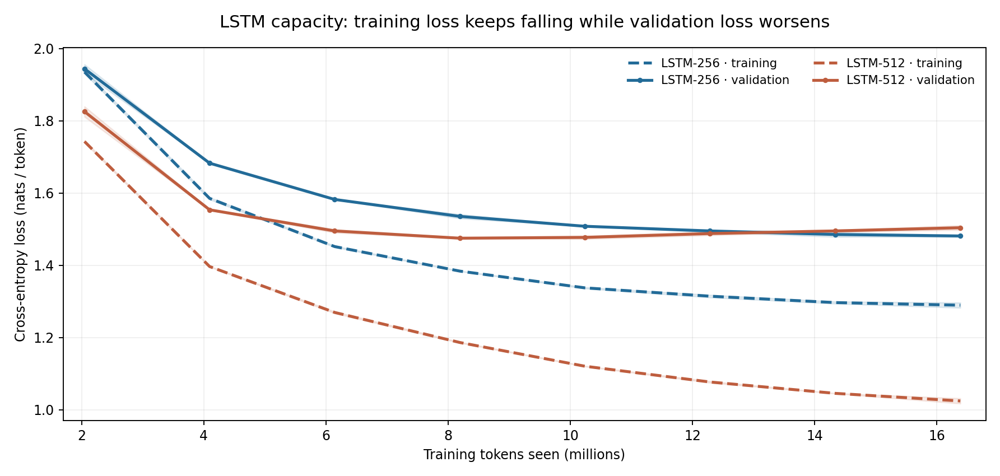

## 3. Task 2 — RNN, GRU, LSTM, and Transformer Comparison

### 3.1 Objective and controlled setup

I compared a vanilla RNN, GRU, 256-unit LSTM, 512-unit LSTM, GPT-2-style Transformer and modern Transformer to examine the practical effects of recurrent gating, model capacity and Transformer design. Every model used Tiny Shakespeare, **2,000 training steps, batch size 32, context length 256, and 16,384,000 training tokens**. Each configuration was run independently with **two seeds (1337 and 42)**, producing 12 completed runs. Validation bpb was the primary metric (lower is better). Per-step learning curves were recorded during training; final tabulated values came from the full validation-set metrics.

The modern Transformer used RMSNorm, RoPE, SwiGLU and no biases; the textbook Transformer used its GPT-2-style configuration. Models were matched for training tokens, not for parameter count, training time, or FLOPs. Sample standard deviation (SD) across two runs is shown to convey limited seed variability.

This is a **reduced laptop-scale version** of the instructor's `sweeps/01_char_models.yaml` experiment, with 2,000 steps per run and a fixed 16,384,000-token training budget. Since the training corpus contains roughly one million characters, the sampled token exposure corresponds to about **16 corpus-length passes**. This is not 16 distinct sequential epochs: the trainer randomly samples windows, so some substrings can be revisited more often than others.

### 3.2 Results

| Architecture | Parameters | Seed 1337 bpb | Seed 42 bpb | Mean ± sample SD (bpb) |
|---|---:|---:|---:|---:|
| Vanilla RNN | 280,320 | 2.4409 | 2.4330 | 2.4369 ± 0.0056 |
| GRU | 806,656 | 2.1612 | 2.1587 | 2.1600 ± 0.0018 |
| LSTM (256) | 1,069,824 | 2.1337 | 2.1405 | 2.1371 ± 0.0048 |
| LSTM (512) | 4,236,800 | 2.1794 | 2.1608 | 2.1701 ± 0.0132 |
| GPT-2-style Transformer | 3,438,336 | 2.1864 | 2.1841 | 2.1852 ± 0.0016 |
| Modern Transformer | 3,162,624 | 2.1165 | 2.1152 | **2.1159 ± 0.0010** |

### 3.3 Q1 — Why does the vanilla RNN fall so far behind?

The vanilla RNN was the weakest of the six architectures, finishing at **2.4369 mean validation bpb**. The GRU reached **2.1600**, and the 256-unit LSTM reached **2.1371**. That means the vanilla RNN remained **0.2769 bpb behind the GRU** and **0.2998 bpb behind the smaller LSTM**, despite all models observing the same number of training tokens. The learning curve shows that the RNN does learn: its validation loss falls as training progresses. The issue is that it plateaus at a much worse level, so the gap is not simply a failed run or insufficient optimizer steps.

A vanilla RNN repeatedly transforms its hidden state as the sequence advances. During backpropagation through time, gradients are multiplied through many recurrent steps; depending on the recurrent dynamics, information from earlier characters can weaken or be distorted. A character model must sometimes preserve context across punctuation, spaces, names, and long-range sentence structure. GRUs introduce update and reset gates, while LSTMs use input, forget, and output gates and an explicit cell state. Those mechanisms make it easier to retain useful information and discard irrelevant context. The fact that both gated models beat the vanilla RNN by large margins is **consistent with** this mechanism.

This is not a perfect controlled test of gating itself. The vanilla RNN has only **280,320 parameters**, compared with **806,656 for the GRU** and **1,069,824 for the LSTM**; model capacity and optimization therefore differ. The defensible conclusion is that, under the same token budget and this configuration, the vanilla RNN generalizes markedly worse, in a way that agrees with known limitations of ungated recurrence.

### 3.4 Q2 — Is the larger LSTM better or worse? What in the curves explains it?

**The larger LSTM is worse at the end of training.** The 512-unit model has **4,236,800 parameters**, approximately **3.96 times** the 256-unit model's 1,069,824. Nevertheless, its final two-seed mean validation bpb is **2.1701**, compared with **2.1371** for the smaller LSTM (a **0.0330-bpb disadvantage**). Early training tells a different story: the larger network reduces validation loss faster and initially reaches lower values. Near **8–10 million tokens**, its validation curve bottoms out; it then turns upward as the smaller model continues to improve or stays nearly flat.

The training-versus-validation logs confirm the generalization gap. At the final step, the larger LSTM has a mean **training cross-entropy of 1.0245 nats/token** but **validation cross-entropy of 1.5042**, a gap of **0.4797**. The smaller LSTM finishes at **1.2896 training / 1.4813 validation**, a much narrower gap of **0.1917**. At the 1,000-step checkpoint, the larger LSTM's gap was approximately **0.2888**; by step 2,000 it had widened to **0.4797**. In other words, extra capacity keeps fitting the training windows even while held-out predictions deteriorate. Both seeds show this late reversal for the larger model.

The roughly **16 corpus-length passes** of training-token exposure on this small Shakespeare corpus make repeated exposure and memorization plausible, although random window sampling means these are not exact full-dataset epochs. Taken together, the **lower training loss, rising validation curve, and widening gap** provide direct evidence of overfitting in the larger LSTM under this training regime. This does not imply that a 512-unit LSTM is inherently inferior: earlier stopping, stronger regularization, or more data could change the comparison. The larger model also has greater two-seed variability (**0.0132 versus 0.0048 bpb sample SD**), reinforcing caution about judging models from one run.

### 3.5 Transformer variants and seed variation

The modern Transformer achieved the lowest validation bpb, **2.1159**, beating the textbook Transformer (**2.1852**) by **0.0693 bpb** while using slightly fewer parameters. Its combination of normalization, rotary positional embeddings, feed-forward activation and bias choices was effective at this scale. Because multiple components changed at once, these runs cannot identify which change caused the gain; that would require an ablation. The modern model performed consistently across the two seeds (2.1165 and 2.1152). Two seeds are adequate for the assigned replication but insufficient for strong significance claims about small differences.

### 3.6 Conclusion

Gated recurrent models performed markedly better than the small vanilla RNN, the larger LSTM displayed diminishing generalization at the end of training, and the modern Transformer was best overall. The learning curves show why final validation results and generalization matter more than parameter count or early learning speed alone.
