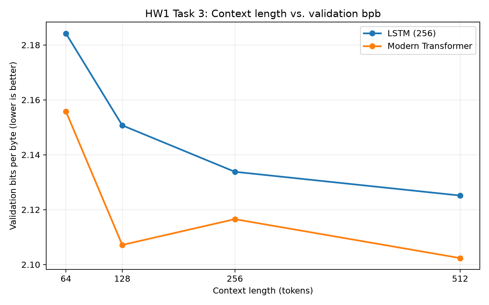

## 4. Task 3 — Effect of Context Length

### 4.1 Objective and setup

I studied whether longer preceding character sequences improved the performance of a 256-unit LSTM and a modern Transformer. For both architectures, context lengths were **64, 128, 256 and 512**. Each setting used **seed 1337** and **2,000 steps**, with batch sizes of **128, 64, 32 and 16**, respectively, keeping the total at **16,384,000 training tokens per run**. The LSTM had 1,069,824 parameters and the Transformer had 3,162,624. Eight runs finished successfully in about 73 minutes on the Mac M4 MPS backend.

Equal token budgets control for token exposure, but the changing batch size can influence optimization. Training FLOPs and attention cost are not equal across architectures or context lengths.

### 4.2 Results

| Context (characters) | Batch size | LSTM bpb | Modern Transformer bpb |
|---|---:|---:|---:|
| 64 | 128 | 2.184226 | 2.155792 |
| 128 | 64 | 2.150726 | 2.107150 |
| 256 | 32 | 2.133803 | 2.116539 |
| 512 | 16 | **2.125149** | **2.102364** |

### 4.3 Where does the LSTM stop benefiting?

The LSTM improved monotonically from **2.184226** at 64 tokens to **2.125149** at 512, an overall reduction of **0.059077 bpb (2.70%)**. Its gains shrink as context grows: **0.033500** bpb from 64→128, **0.016924** from 128→256 and only **0.008654** from 256→512. The incremental gain is **below 0.01 bpb only for the 256→512 increase**, which gives a concrete threshold for diminishing returns. Therefore, the curve shows **diminishing returns after approximately 256 characters**, but not a complete plateau: its best score in the tested range is still at 512. A recurrent network has to compress the past into finite-dimensional hidden and cell states, limiting how efficiently it can preserve very distant detail.

### 4.4 Where does the Transformer stop benefiting?

The Transformer decreased bpb by **0.048642** from context 64 to 128, worsened by **0.009390** from 128 to 256, and improved by **0.014175** from 256 to 512. Its best observed value was **2.102364 at 512**; hence, **no clear plateau was established** within the tested contexts. This one-seed non-monotonic pattern may reflect training variability or changing batch sizes rather than evidence that 256-character context is intrinsically worse. The net 64→512 improvement was **0.053428 bpb (2.48%)**. Importantly, **the improvement from 128 all the way to 512 is only 0.004786 bpb** (2.107150 − 2.102364): the bulk of the total gain is achieved by 128 characters, even though the best measured score is at 512. Thus 128 is a practical *near-saturation point* in these data, without being a proven plateau.

### 4.5 Which architecture uses longer context more effectively?

**The modern Transformer is the better architecture in absolute validation quality at every measured context length**: 2.155792 versus 2.184226 at 64, 2.107150 versus 2.150726 at 128, 2.116539 versus 2.133803 at 256, and 2.102364 versus 2.125149 at 512 (Transformer listed first each time). It also reaches lower bpb with only 128 characters than the LSTM obtains at 512 characters (2.107150 versus 2.125149). That is the clearest result when the question is which architecture performs better while incorporating context.

However, using **incremental proportional improvement** instead of absolute bpb leads to a more qualified answer. However, the LSTM had a *slightly larger overall proportional improvement* between 64 and 512 (2.70% versus 2.48%). Thus, this experiment does **not** prove the Transformer gains more from each extra unit of context. Self-attention can access earlier positions directly, providing a plausible mechanism for long-range information use, but one seed per setting and unequal parameter counts limit causal conclusions.

### 4.6 Conclusion

Longer context helped both models overall. The LSTM showed steady but diminishing gains beyond about 256 characters; the Transformer gave the strongest final bpb at 512, with no stable saturation point established in the tested range.
