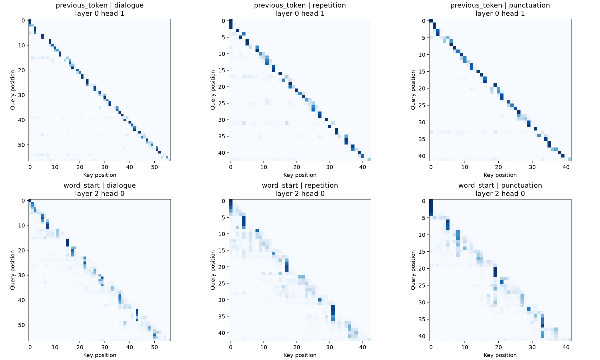

## 5. Task 4 — Attention Head Analysis

### 5.1 Objective and setup

This experiment inspected the attention matrices of the **trained modern Transformer with 512-character context and seed 1337** from Task 3, whose validation bpb was **2.102364**. No additional model training was performed. I used the professor's `nanolm.viz attention` functionality and attention-weight extraction to analyze **16 heads (four layers × four heads)** on three character sequences: dialogue, repetition and punctuation. Layer/head indices are zero-based.

| Text type | Input |
|---|---|
| Dialogue | `ROMEO:\nBut soft! what light through yonder window breaks?` |
| Repetition | `the king and the queen and the king return.` |
| Punctuation | `To be, or not to be: that is the question.` |

The dialogue string was passed as the Python string `"ROMEO:\nBut soft! what light through yonder window breaks?"`, where `\n` represents **one real newline character**, not two literal characters `\` and `n`. The actual string has **57 characters**, hence **56 valid previous-token queries** at positions t > 0. This verifies the reported count and avoids an out-of-distribution literal-backslash input.

The selected head averages were calculated over eligible query positions. The uniform-causal reference is the mean of **1/(t + 1)** over those positions, not a fixed attention percentage; this accounts for how many past and current positions each query is allowed to attend to.

### 5.2 Pattern A: previous-token attention

For each query at position **t > 0**, I measured its weight assigned to the previous position **t − 1**. **Layer 0, Head 1** gave the clearest previous-token candidate, with a pooled average **50.35% attention** across **139 eligible query positions**, compared with **7.41%** under the uniform-causal reference (**6.79× enrichment**).

| Input | Eligible queries | Previous-token weight | Uniform baseline |
|---|---:|---:|---:|
| Dialogue | 56 | 49.72% | 6.48% |
| Repetition | 42 | 47.52% | 7.98% |
| Punctuation | 41 | 54.09% | 8.11% |
| **Pooled** | **139** | **50.35%** | **7.41%** |

The upper heatmaps in Figure 3 show a strong band just below the diagonal: current positions repeatedly attend to the preceding character. Such a local pattern may help recognize common character transitions and short motifs.

### 5.3 Pattern B: current-word-start attention

For each noninitial letter within a word, I measured the attention directed toward the **first letter of that same word**. **Layer 2, Head 0** assigned a pooled average of **44.13%** across **82 eligible positions**, compared with a **7.50%** uniform-causal reference (**5.89× enrichment**).

| Input | Eligible queries | Word-start weight | Uniform baseline |
|---|---:|---:|---:|
| Dialogue | 37 | 43.26% | 6.83% |
| Repetition | 25 | 51.75% | 8.51% |
| Punctuation | 20 | 36.24% | 7.48% |
| **Pooled** | **82** | **44.13%** | **7.50%** |

The lower heatmaps show vertical concentrations at earlier letters within the current word, consistent with a head that revisits word beginnings while predicting later letters. It may help preserve lexical context during character generation.

### 5.4 Interpretation and limitations

Both candidates appeared across dialogue, repeated phrases and punctuation, though their strengths differed. The previous-token head was comparatively stable (**47.52–54.09%**), whereas word-start attention varied from **36.24–51.75%**. These are descriptive measurements from short inputs and one checkpoint. A large attention weight is **not proof of a head's exclusive purpose or causal contribution** to model predictions, especially because heads were selected after inspecting all 16. Nonetheless, the quantified patterns and heatmaps satisfy the assignment's request for two interpretable head types supported by average attention weights.
