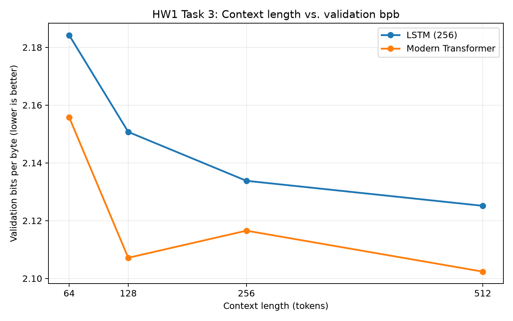

# Task 3: Context length

All eight runs use the same token budget and seed.

| Model | Context | Batch | Parameters | Validation bpb |
|---|---:|---:|---:|---:|
| lstm | 64 | 128 | 1,069,824 | 2.184226 |
| lstm | 128 | 64 | 1,069,824 | 2.150726 |
| lstm | 256 | 32 | 1,069,824 | 2.133803 |
| lstm | 512 | 16 | 1,069,824 | 2.125149 |
| gpt_modern | 64 | 128 | 3,162,624 | 2.155792 |
| gpt_modern | 128 | 64 | 3,162,624 | 2.107150 |
| gpt_modern | 256 | 32 | 3,162,624 | 2.116539 |
| gpt_modern | 512 | 16 | 3,162,624 | 2.102364 |

Context-length saturation and interpretation should be written after reviewing these results.
